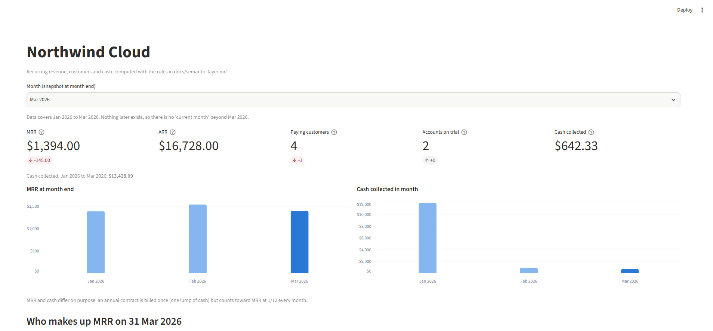
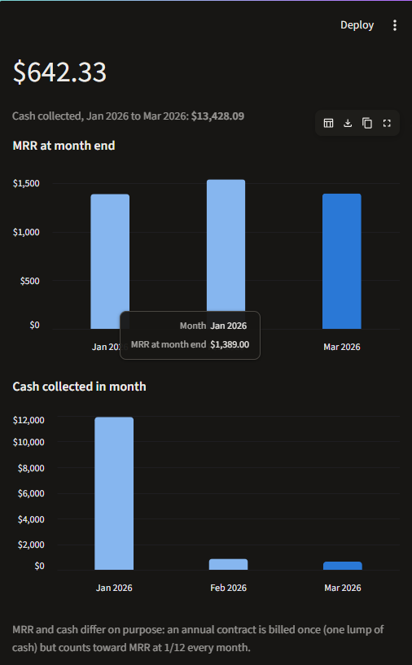
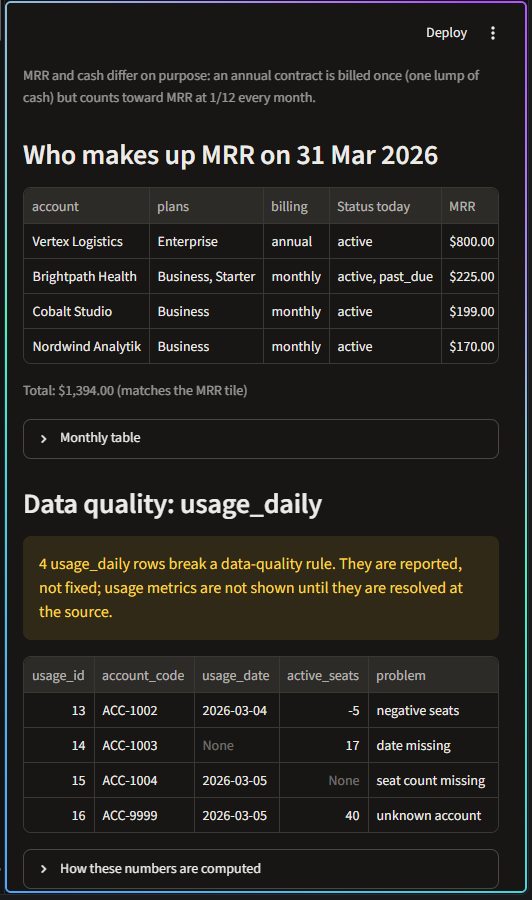
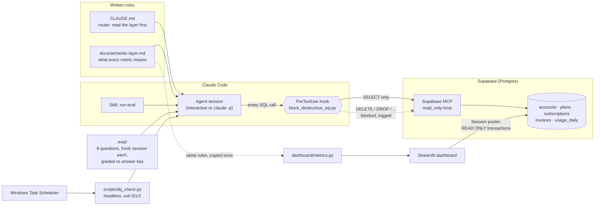

# Northwind Cloud Data Platform

Northwind Cloud sells subscriptions to businesses, and its numbers lived in a
production database that nobody had documented. Analysts kept asking the same
questions by hand (what's our MRR, how many paying customers, how much cash
came in) and got different answers depending on who wrote the SQL. This repo
is the platform that answers those questions **the same way every time**: a
written definition of every metric, an AI agent that must follow it, guards
that stop the agent from changing data, a data-quality check that runs on a
schedule by itself, and a dashboard anyone can open.

<p align="center">
  
  
  
</p>

*The dashboard for March 2026: MRR **$1,394**, **4** paying customers,
**2** trials, **$13,428.09** cash collected in Q1. Every figure matches the
graded eval answers.*

---

## Architecture



Two paths reach the database, and both apply the same written rules:

- **Agents** go through the Supabase MCP server, behind three independent
  locks: a read-only server, deny rules in `.claude/settings.json`, and a hook
  that inspects every SQL statement.
- **The dashboard** queries Postgres directly with plain SQL (fast and
  deterministic), and all of that SQL is built from the semantic layer's rules
  in one file.

---

## What each component does, and why it exists

| # | Component | Where | What it does | What goes wrong without it |
|---|---|---|---|---|
| 1 | **Connection + permissions** | [`.mcp.json`](.mcp.json), [`.claude/settings.json`](.claude/settings.json), [`docs/permissions.md`](docs/permissions.md) | Connects Claude to Supabase **read-only**, denies the full-access connector, denies reading the answer key and secrets, asks before `git push` | An agent with write access to production, and an eval it can cheat on |
| 2 | **Semantic layer** | [`docs/semantic-layer.md`](docs/semantic-layer.md), [`CLAUDE.md`](CLAUDE.md) | Defines MRR, paying customers, trials and cash collected, with canonical SQL, the status vocabulary and 13 gotchas (annual contracts ÷ 12, exclude trials and internal demo tenants, month-end snapshot by dates) | Every analyst, and every agent run, picks its own definition. The numbers look plausible and disagree. |
| 3 | **Eval** | [`eval/`](eval/), [`eval/FINDINGS.md`](eval/FINDINGS.md) | 5 accuracy questions plus 3 phrasings of one question that must agree. Each runs in a fresh headless session and is graded against an answer key the agent can't read. | No evidence the agent is right, only that it sounds confident |
| 4 | **Skill** | [`.claude/skills/run-eval/`](.claude/skills/run-eval/SKILL.md) | `/run-eval` runs the whole eval the same way each time: ask, save, grade, compare, read the answers for hedges | The procedure lives in someone's head, and it drifts |
| 5 | **Guard hook** | [`.claude/hooks/block_destructive_sql.py`](.claude/hooks/block_destructive_sql.py) | Reads every SQL statement before it leaves the machine. Allows only `SELECT`/`WITH`/`EXPLAIN`; blocks `DELETE`, `DROP`, `UPDATE`, stacked statements, writes hidden in comments or CTEs; logs every decision. [Proof it fired](docs/evidence/hook-proof.md) in a fresh session. | A rule in `CLAUDE.md` is a *request*. If the read-only flag is ever flipped, nothing stops "clean up the bad rows" from deleting production data. |
| 6 | **Headless check + schedule** | [`scripts/dq_check.py`](scripts/dq_check.py), [`scripts/run_dq_scheduled.cmd`](scripts/run_dq_scheduled.cmd) | Checks `usage_daily` against the layer's data-quality rules. Returns structured JSON and an exit code (0 pass, 1 issues found, 2 couldn't check), with budget, turn and tool limits. Ran unattended from Task Scheduler. | Bad data is found only when a number looks wrong in a board meeting |
| 7 | **Dashboard** | [`dashboard/`](dashboard/) | MRR, ARR, paying customers, trials and cash by month; MRR by account; data-quality issues shown, not hidden | Numbers stay locked inside SQL and agent chats. A dashboard with the *wrong* rules is worse: polish manufactures trust. |

### Results that matter

- **Eval:** 5/5 accuracy and consistency PASS, both before and after the
  semantic layer. The score didn't move, but the answers did. Without the
  layer the agent guessed the conventional rules and hedged three times ("if
  you exclude past_due it would be..."). With it, every answer cited the
  definition and gave one number, at **40% lower cost**. The write-up,
  including what this eval *can't* detect, is in
  [`eval/FINDINGS.md`](eval/FINDINGS.md).
- **Hook:** in a fresh session asked to delete the bad usage row, the hook
  blocked the `DELETE`, and the row is still there for the data-quality check
  to find. Evidence: [`docs/evidence/`](docs/evidence/) and
  [`logs/hook.log`](logs/hook.log).
- **Scheduled check:** Task Scheduler ran it on 2026-11-18 at 16:14:00 with
  nobody at the keyboard. It found all four seeded problems (negative seats,
  missing date, missing seat count, unknown account) and returned exit code 1.
  Evidence: [`logs/dq_check.log`](logs/dq_check.log), with
  `"invoked_by": "task-scheduler"`. **The schedule was then deleted**: a job
  nobody needs is just recurring cost and an open door.
- **Dashboard:** every figure matches the eval answers, and the per-account
  rows add up to the MRR tile.

---

## How to run it

**Prerequisites:** Python 3.12+, [Claude Code](https://claude.com/claude-code),
and a Supabase project with the Northwind tables loaded from `schema.sql`.

```bash
git clone <this repo> && cd final-project
pip install -r requirements.txt
```

**1. Connect the agent.** `.mcp.json` points at project ref
`egzungqlpsseljrcokmy`. Change it to your own project. Then start `claude` in
this folder, accept the folder-trust prompt, and run `/mcp` to log in to the
Supabase server. Headless runs (`claude -p`) need that trust saved for this
exact folder, or they ignore the allow rules.

**2. Ask a question.** In Claude Code: *"Using Supabase, what was our MRR in
March 2026?"* It reads the semantic layer first and answers 1394.00.

**3. Run the eval** (about $1, a few minutes):
```bash
python eval/ask_questions.py --label after --out eval/results.yaml
cd eval && python run_eval.py results.yaml
```
or just `/run-eval` inside Claude Code.

**4. Run the data-quality check:**
```bash
python scripts/dq_check.py        # prints a JSON report; exit 1 = issues found
```
To schedule it on Windows, point a Task Scheduler task at
`scripts/run_dq_scheduled.cmd`. With cron, call `scripts/dq_check.py` from the
repo root.

**5. Start the dashboard.** Copy
[`.streamlit/secrets.toml.example`](.streamlit/secrets.toml.example) to
`.streamlit/secrets.toml` (git-ignored) and fill in the **Session pooler**
details from Supabase → Connect. The direct host is IPv6-only and fails on
many networks. Then:
```bash
streamlit run dashboard/app.py    # http://localhost:8501
```

**Tests for the hook:**
```bash
python -m unittest tests/test_block_destructive_sql.py -v
```

---

## Limitations, and what I'd build next

- **The eval is too easy to separate good definitions from lucky ones.** It
  only asks about March and Q1, where the `status` column happens to agree with
  the dates. Next: questions about February (where filtering on status
  understates MRR), mid-month upgrades, repeated runs to measure variance, and
  a question the data can't answer. Proposals are in
  [`eval/FINDINGS.md`](eval/FINDINGS.md).
- **The dashboard logs in as `postgres`.** Its transactions are read-only, but
  the right fix is a dedicated read-only database role with `SELECT` on the
  five Northwind tables only.
- **The hook is a word filter, not a SQL parser.** It errs toward blocking
  (`SELECT ... FOR UPDATE` is refused). A function with side effects that
  isn't on its list could get through, which is why it's the third lock, not
  the only one.
- **Shell deny rules are blunt.** They match text, so they block harmless
  commands that mention a protected filename and can miss creative ones. A
  personal `settings.local.json` can also loosen them.
- **The schedule ran on a laptop**, as the logged-in user. Production needs an
  always-on host or a cloud scheduler, a service account, alerts on exit codes
  1 and 2, and log rotation.
- **Data ends in March 2026.** The dashboard and agent say so rather than
  presenting March as "now". There's no pipeline loading new data.
- **One currency.** All data is USD. The dashboard refuses to sum mixed
  currencies rather than handling them.

---

## Repo map

| Path | What |
|---|---|
| `docs/semantic-layer.md` | Business definitions, the source of truth |
| `docs/permissions.md` | Why the agent may and may not do each thing |
| `docs/build-journal.md` | Step-by-step build log: what, why, how it was verified |
| `docs/plans/` | The plan made in plan mode before building the hook |
| `docs/evidence/` | Transcripts proving the hook fired |
| `eval/` | Questions, runner, grader, saved runs, findings |
| `scripts/` | Headless data-quality check and its scheduler launcher |
| `dashboard/` | Streamlit app; all SQL in `metrics.py` |
| `logs/` | Hook decisions and data-quality runs (kept as evidence) |
| `tests/` | Unit tests for the hook |
